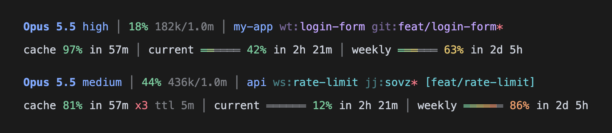

# Claude Code statusline

A portable Claude Code status-line bundle with live context usage, subscription
rate bars, worktree-aware paths, effort indicators, and custom subagent rows.

This public repository is the canonical source for the three runtime scripts.
The [shared harness](https://github.com/Gaotity/harness) pins it as a submodule
at `components/claude-code-statusline`, and chezmoi deploys the pinned scripts.
The bundle and its tests work independently of those repositories.



## Components

- `statusline.sh` renders the main Claude Code status line.
- `mod/` is the `subagent-rows` Claude Code mod. It renders one custom row per
  subagent.
- `subagent-statusline.sh` renders the same rows through the deprecated
  `subagentStatusLine` setting.
- `lib/statusline-cache.sh` performs non-blocking usage refresh, credential
  lookup, and locking.

The render path reads local state. Network refresh runs asynchronously, so the
prompt is never blocked by the Anthropic usage endpoint. The former context
handoff for reminder hooks is retired; the current runtime does not write a
context-usage file.

## Layout

Line 1 shows the model, the context, the directory, and the extra usage. Line 2
starts with the prompt cache, and then shows the usage windows of the account.

The directory segment uses labels to show four types of location:

| Location | Example |
| --- | --- |
| Git branch | `repo git:main*` |
| Git linked worktree | `repo wt:topic git:feature/topic` |
| jj change | `repo jj:otln [main]` |
| jj secondary workspace | `repo ws:topic jj:zrpz*` |

- A directory with `.jj` at or above the session directory is a jj
  repository, also when Git is colocated.
- jj labels are teal, and Git labels are lavender.
- In a worktree or a secondary workspace, `repo` is the name of the main
  repository.
- A jj segment shows the newest bookmark on `@` or `@-` in brackets.
- If Git `HEAD` is detached, the Git segment shows the short commit ID.
- The jj query does not record a snapshot of the working copy. Thus the jj
  dirty mark shows the state at the last jj command.

## Git state cache

The directory segment shows the change or branch and a dirty mark (`*`). Each
render of each session needs this data, and a large repository makes the Git
status scan slow. The script keeps the result for each working directory in
the runtime directory, in a file named `statusline-git-<hash>`. It uses the
file again for 30 seconds.

- `CLAUDE_STATUSLINE_GIT_TTL` sets the time in seconds. The value `0` turns the
  cache off. An invalid value gives the default of 30. A valid value has 1 to 9
  digits.
- If `GIT_DIR`, `GIT_WORK_TREE`, `GIT_COMMON_DIR`, or `GIT_INDEX_FILE` is set,
  the cache is off. These variables change the repository that Git reads, and
  the cache key has only the directory.
- `CLAUDE_STATUSLINE_RUNTIME_DIR` sets the directory. The default is
  `/tmp/claude`.
- A missing, corrupt, or unwritable cache file does not cause an error. The
  script then reads the live Git state. The script reads only a regular file, so
  a FIFO at the path of the file cannot stop the render.
- The dirty mark shows only changes to tracked files. An untracked file does
  not set it.
- A change shows in the status line up to the TTL after it occurs.

## Requirements

- Bash
- [jq](https://jqlang.github.io/jq/)
- [curl](https://curl.se/)
- Git

On macOS, install `jq` with `brew install jq` if needed.

## Install

The installer downloads all three components, backs up an existing
`~/.claude/settings.json` when it needs to change it, and merges both
`statusLine` and `subagentStatusLine`.

```bash
curl -fsSL https://raw.githubusercontent.com/Winn-Gaoti-Studio/claude-code-statusline/main/install.sh | bash
```

Restart Claude Code after installation. To uninstall:

```bash
curl -fsSL https://raw.githubusercontent.com/Winn-Gaoti-Studio/claude-code-statusline/main/uninstall.sh | bash
```

The uninstaller restores the original settings backup when available. Without a
backup, it removes only the two status-line keys and preserves unrelated
settings. The installer records the original settings once per installation;
when no settings file existed, it records that state separately. Uninstall
removes these bundle-owned records after restoring or updating settings.

## Manual install

```bash
mkdir -p ~/.claude/lib
curl -fsSL https://raw.githubusercontent.com/Winn-Gaoti-Studio/claude-code-statusline/main/statusline.sh \
  -o ~/.claude/statusline.sh
curl -fsSL https://raw.githubusercontent.com/Winn-Gaoti-Studio/claude-code-statusline/main/subagent-statusline.sh \
  -o ~/.claude/subagent-statusline.sh
curl -fsSL https://raw.githubusercontent.com/Winn-Gaoti-Studio/claude-code-statusline/main/lib/statusline-cache.sh \
  -o ~/.claude/lib/statusline-cache.sh
chmod +x ~/.claude/statusline.sh ~/.claude/subagent-statusline.sh
```

Add these settings to `~/.claude/settings.json`:

```json
{
  "statusLine": {
    "type": "command",
    "command": "bash \"$HOME/.claude/statusline.sh\"",
    "refreshInterval": 30
  },
  "subagentStatusLine": {
    "type": "command",
    "command": "bash \"$HOME/.claude/subagent-statusline.sh\""
  }
}
```

## Subagent rows mod

Claude Code deprecated `subagentStatusLine` in favor of mods. The
`subagent-rows` mod in `mod/` gives the same rows through an `AgentRow` render
hook. The installer above still uses `subagentStatusLine`. The `AgentRow`
hook needs Claude Code 2.1.326 or later. On an earlier version, keep
`subagentStatusLine`.

To use the mod, copy the `mod/` directory to a local directory. Then name that
directory in the `env` block of `~/.claude/settings.json`, and remove
`subagentStatusLine`:

```json
{
  "env": {
    "CLAUDE_CODE_PLUGIN_DIRS": "~/.claude/mods/subagent-rows"
  }
}
```

Claude Code does not give the mod the row of a workflow. That row keeps the
default format.

## Development

Run all checks from this repository:

```bash
bash tests/check.sh
```

`tests/subagent-mod.parity.sh` compares the rows of the mod with the rows of
`subagent-statusline.sh`. It needs a Node version that can import TypeScript
with `--experimental-strip-types` (Node 22.7 or later). For a change to the mod,
also do these commands:

```bash
claude plugin validate mod
claude plugin test mod
```

The suite uses synthetic home directories and fake credential and network
commands. It needs no Claude credentials, private repository, or live network
connection. `tests/runtime.smoke.sh` carries the full runtime behavior checks;
`tests/render.smoke.sh` provides a short render check, and
`tests/install-uninstall.sh` covers the local installation path.

## Security

No OAuth token is stored in this repository. At runtime, the cache helper checks
`CLAUDE_CODE_OAUTH_TOKEN`, macOS Keychain, Claude Code's local credentials
file, or Linux Secret Service. Tokens are passed to `curl` through a header on
standard input and are never logged.

Credentials, sessions, transcripts, caches, and machine-specific configuration
are excluded.

## Credits

Inspired by
[kamranahmedse/claude-statusline](https://github.com/kamranahmedse/claude-statusline).

## License

[MIT](./LICENSE). Portions originally from `kamranahmedse/claude-statusline`
(MIT, © Kamran Ahmed).
